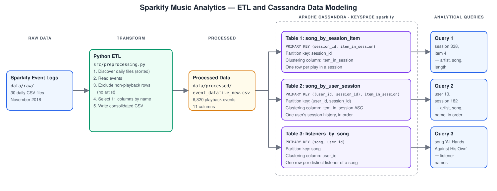

# Sparkify Music Analytics | Data Modeling with Apache Cassandra

## Project Overview
Sparkify is the fictional music-streaming scenario used in this project. Its analytics team wants to know what users listen to, but the activity data sits in a directory of daily CSV files that are hard to query. This project consolidates those logs with a Python ETL and models **three Apache Cassandra tables, each designed around one analytical question**, so every query is answered from a single partition without `ALLOW FILTERING`, joins or indexes.

It is a learning project built on a course-provided sample dataset, not a production system.

## Solution Architecture


Daily event files in `data/raw/` are read by a Python ETL, which drops non-playback events and writes one consolidated CSV. The notebook loads that file into three Cassandra tables, one per query, and runs the three analytical queries. The diagram is editable: [`docs/architecture.drawio`](docs/architecture.drawio).

## Technologies
**Core:** Python, Apache Cassandra 4.1, CQL, Cassandra Python driver, pandas
**Tooling:** Jupyter Notebook, pytest, Docker Compose (local Cassandra)

## Dataset
- 30 daily event files (`2018-11-01` to `2018-11-30`) with 17 columns, mixing song plays with other activity such as page visits.
- Rows without an artist are non-playback events and are excluded.
- **6,820 playback records** remain, with 11 selected columns: `artist, firstName, gender, itemInSession, lastName, length, level, location, sessionId, song, userId`.
- The data comes from a Data Engineering course exercise. See [Data provenance](#data-provenance-and-privacy).

## Query-Driven Data Modeling
Cassandra stores rows by partition key and orders them by clustering columns, so the primary key decides which queries a table can serve. One table is therefore built per query.

| Table | Primary key | Partition key | Clustering column | One row per |
|---|---|---|---|---|
| `song_by_session_item` | `(session_id, item_in_session)` | `session_id` | `item_in_session` | play in a session |
| `song_by_user_session` | `((user_id, session_id), item_in_session)` | `(user_id, session_id)` | `item_in_session` (`ASC`) | play by a user in a session |
| `listeners_by_song` | `(song, user_id)` | `song` | `user_id` | distinct listener of a song |

The reasoning behind each key, the uniqueness assumptions and the limits of the design are in [`docs/data-model.md`](docs/data-model.md).

## Analytical Queries and Results
Results below were recorded from the sample data (see [verification](docs/verification.md) for how they were produced and checked).

**Query 1** (`song_by_session_item`): artist, song and length for session 338, item 4.

| artist | song | length |
|---|---|---|
| Faithless | Music Matters (Mark Knight Dub) | 495.3073 |

**Query 2** (`song_by_user_session`): artist, song and user name for user 10, session 182. Rows come back in `itemInSession` order because of the clustering order, with no `ORDER BY`.

| item | artist | song | user |
|---:|---|---|---|
| 0 | Down To The Bone | Keep On Keepin' On | Sylvie Cruz |
| 1 | Three Drives | Greece 2000 | Sylvie Cruz |
| 2 | Sebastien Tellier | Kilometer | Sylvie Cruz |
| 3 | Lonnie Gordon | Catch You Baby (Steve Pitron & Max Sanna Radio Edit) | Sylvie Cruz |

**Query 3** (`listeners_by_song`): users who listened to "All Hands Against His Own": Jacqueline Lynch, Tegan Levine, Sara Johnson.

## ETL Workflow
1. Find the top-level `*.csv` files in `data/raw/` in sorted order.
2. Read each file with a header-aware CSV reader and keep rows with an artist.
3. Write the 11 required columns, in order, to `data/processed/event_datafile_new.csv`. The file is rewritten on every run, so re-running does not duplicate rows.
4. In the notebook, load each table with a prepared `INSERT` statement. Empty values in required fields raise an error instead of being loaded.

The preprocessing code is in [`src/preprocessing.py`](src/preprocessing.py) and is shared by the notebook and the tests.

## Data Validation
- **Row counts vs. distinct keys:** each table's Cassandra row count equals the number of distinct primary keys in the CSV.

  | Table | Distinct source keys | Cassandra rows |
  |---|---:|---:|
  | `song_by_session_item` | 6,820 | 6,820 |
  | `song_by_user_session` | 6,820 | 6,820 |
  | `listeners_by_song` | 6,618 | 6,618 |

  `listeners_by_song` has fewer rows because it stores distinct listeners: 155 song and user pairs were played more than once and collapse into one row each.
- **Answers vs. source data:** the notebook recomputes each query's answer from the CSV with pandas and asserts they match, including the row order of Query 2.
- **Unit tests:** `pytest` covers file discovery, the output schema, playback filtering, repeatable output, key uniqueness and small edge-case fixtures. No Cassandra server is needed.

Details and the exact scope of what was run are in [`docs/verification.md`](docs/verification.md).

## Running Locally
Requires Python 3.10+ and Docker.

```bash
# 1. Start Cassandra and wait until it is healthy (about a minute)
docker compose up -d
docker compose ps            # STATUS should show "healthy"

# 2. Install dependencies
python -m venv .venv && source .venv/bin/activate
pip install -r requirements.txt

# 3. Run the unit tests (no Cassandra needed)
pytest

# 4. Open the notebook and run all cells
jupyter notebook notebooks/sparkify_cassandra_modeling.ipynb

# 5. Stop and remove the container (the data is not persisted)
docker compose down
```

The notebook retries the connection while Cassandra finishes starting. By default it connects to `127.0.0.1:9042`; set `CASSANDRA_HOST` and `CASSANDRA_PORT` to change that.

**Resetting tables:** with `RESET_TABLES = True` (the default) each table cell drops and recreates only its own table in the `sparkify` keyspace. Set it to `False` to keep existing tables; loads are upserts, so reloading does not create duplicates. The last cells hold an optional `DROP_TABLES` switch and close the connection.

## Engineering Decisions and Trade-offs
- **One table per query, with duplicated data.** This is how Cassandra is meant to be used. The cost is storing each play three times and keeping the copies consistent.
- **Composite partition key for Query 2.** `(user_id, session_id)` matches the two filters in the query and keeps one user's session in one partition.
- **`user_id` as a clustering column in Table 3.** It makes each listener a distinct row, and repeated plays naturally upsert the same row.
- **Server-side ordering.** `CLUSTERING ORDER BY` returns Query 2 in play order, with no sort in application code.
- **Prepared statements** for all inserts, and strict conversion of required fields.
- **Kept deliberately small.** No orchestration, streaming or cloud services: they would not help demonstrate the modeling.

## Limitations
- Local single node, replication factor 1, about 7,000 rows. This shows the modeling technique, not production performance or availability.
- Table 1 assumes `session_id` is unique across users; the sample data satisfies this, but the source does not guarantee it.
- Popular songs would create large partitions at real scale, and the three tables are loaded together but not kept in sync transactionally. Both are discussed in [`docs/data-model.md`](docs/data-model.md).
- Sparkify is fictional, and no business impact is claimed.

## Project Structure
```text
.
├── README.md
├── requirements.txt
├── docker-compose.yml         # single-node Cassandra 4.1 for local use
├── notebooks/
│   └── sparkify_cassandra_modeling.ipynb   # ETL, tables, queries, validation
├── src/
│   └── preprocessing.py       # ETL functions shared by notebook and tests
├── data/
│   ├── raw/                   # 30 daily event files
│   └── processed/event_datafile_new.csv
├── docs/
│   ├── data-model.md
│   ├── verification.md
│   ├── portfolio-summary.md
│   ├── architecture.drawio
│   └── images/architecture.svg
└── tests/test_preprocessing.py
```

## Data Provenance and Privacy
The event files come from a course exercise (Udacity Data Engineering) and contain simulated users with first and last names and locations. I could not verify a redistribution licence for them, so they are included only to make this learning project reproducible. If you are the rights holder and want them removed, please open an issue. Do not reuse this data for other purposes without checking its terms.

## Further Documentation
- [Cassandra data model](docs/data-model.md)
- [Verification report](docs/verification.md)
- [Architecture diagram (editable)](docs/architecture.drawio)
- [Portfolio summary](docs/portfolio-summary.md)
- [Notebook](notebooks/sparkify_cassandra_modeling.ipynb)
