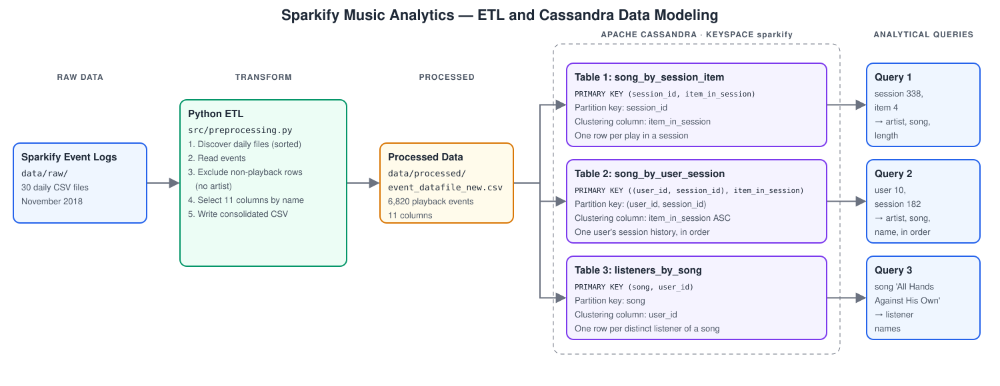

# Cassandra Data Model

This project builds **three tables from one dataset, one per query**. That is deliberate, and it is the main idea in Cassandra data modeling. This document explains why, how each key was chosen, and where the design has limits.



## Why Cassandra needs a table per query

In a relational database you store each fact once and answer different questions with joins, `WHERE` clauses and indexes. Cassandra does not work that way. A table's **primary key decides how the data is physically stored and which queries it can answer efficiently**:

- The **partition key** decides *which node* holds a row. A query must give the full partition key (with equality), or Cassandra would have to ask every node.
- The **clustering columns** decide *how rows are ordered inside a partition*, so ranges and ordering come for free.

So you start from the question, then design the key for it. The same play event is stored three times, in three shapes. Without that, you would need `ALLOW FILTERING` (scan everything and filter), which does not scale and is not used anywhere in this project.

Rule used for every table: **the `WHERE` clause must be exactly the primary key (partition key, then optionally clustering columns).**

## Source columns

`event_datafile_new.csv` has 11 columns: `artist, firstName, gender, itemInSession, lastName, length, level, location, sessionId, song, userId`. Each row is one song play. `itemInSession` is the position of that play inside a session (0, 1, 2, ...).

## Query 1: what was played at a given position of a given session?

> Artist, song title and length for `sessionId = 338` and `itemInSession = 4`.

```sql
CREATE TABLE song_by_session_item (
    session_id int, item_in_session int,
    artist text, song text, length double,
    PRIMARY KEY (session_id, item_in_session)
);

SELECT artist, song, length FROM song_by_session_item
WHERE session_id = 338 AND item_in_session = 4;
```

- **Partition key `session_id`:** the query supplies it, so Cassandra goes to one partition. All plays of a session are stored together.
- **Clustering column `item_in_session`:** the query supplies it, so Cassandra reads one row from that partition. No join and no filtering are needed.
- **Uniqueness assumption:** one play is identified by `(session_id, item_in_session)`. This holds in the dataset: all 6,820 pairs are distinct and no session belongs to more than one user. If two plays ever shared the same pair, the later insert would silently overwrite the earlier one.

## Query 2: what did one user play in one session, in order?

> Artist, song and user name (first and last) for `userId = 10`, `sessionId = 182`, sorted by `itemInSession`.

```sql
CREATE TABLE song_by_user_session (
    user_id int, session_id int, item_in_session int,
    artist text, song text, first_name text, last_name text,
    PRIMARY KEY ((user_id, session_id), item_in_session)
) WITH CLUSTERING ORDER BY (item_in_session ASC);

SELECT artist, song, first_name, last_name FROM song_by_user_session
WHERE user_id = 10 AND session_id = 182;
```

- **Composite partition key `(user_id, session_id)`:** the double parentheses mean both columns together form the partition key. The query supplies both, so it lands on one partition holding exactly that user's plays in that session.
- **Clustering column `item_in_session`, `ASC`:** rows are stored in play order on disk. The query has no `ORDER BY`, and nothing is sorted in Python: Cassandra returns rows already in order.
- **Result for the sample data:** four plays (items 0 to 3) for the same user.

## Query 3: which users listened to a given song?

> First and last name of every user who listened to `All Hands Against His Own`.

```sql
CREATE TABLE listeners_by_song (
    song text, user_id int,
    first_name text, last_name text,
    PRIMARY KEY (song, user_id)
);

SELECT first_name, last_name FROM listeners_by_song
WHERE song = 'All Hands Against His Own';
```

- **Partition key `song`:** the query supplies it.
- **Clustering column `user_id`:** this is what makes each listener a separate row. With `song` alone as the key, every listener would overwrite the previous one and only one name would come back.
- **Plays versus listeners:** the question asks for *users*, not plays. If a user plays a song three times, the three inserts hit the same `(song, user_id)` key and collapse into one row, which is the wanted behaviour. In the data there are 6,820 plays but 6,618 distinct (song, user) pairs; 155 pairs were played more than once. For this song there are 3 plays and 3 distinct listeners.
- If the question had been "how many times was each song played", this table would need a different key (for example a play timestamp or counter column).

## Trade-offs and limitations

**Denormalization and duplication.** The same play appears in three tables. Storage is cheap in Cassandra; the cost is write amplification and the need to keep the copies in sync. Here the tables are loaded together from one file, so they cannot drift apart. In a live system, the writes to all three tables would need to succeed together (for example with a logged batch or an application-level retry), and that is not implemented here.

**Partition size.** A partition should stay reasonably small. In this dataset the largest session has 117 plays and no song has more than 22 distinct listeners, so partitions are tiny. At real scale, `listeners_by_song` could grow unevenly: a very popular song would put every listener in a single partition, which becomes a hotspot. A common remedy is to add a bucket (for example a date or a hash bucket) to the partition key, at the price of querying several partitions. This was not needed or tested here.

**Session ID uniqueness.** Table 1 treats `session_id` as unique across the system. The sample data supports that (776 sessions, none shared between users), but the source does not guarantee it. If session IDs were reused by different users, `song_by_session_item` would overwrite plays. Adding `user_id` to the partition key would remove the risk, but then Query 1 could no longer be answered from session and item alone.

**Fixed queries.** Each table answers its own question well and almost nothing else. A new question (for example "all songs by artist") needs a new table. That is the design cost of query-first modeling.

**Scale.** This is a local single-node setup (replication factor 1) with about 7,000 rows. It demonstrates the modeling technique; it is not evidence of production performance, multi-node behaviour or high availability.
